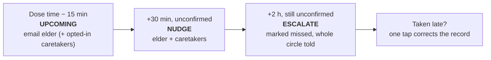
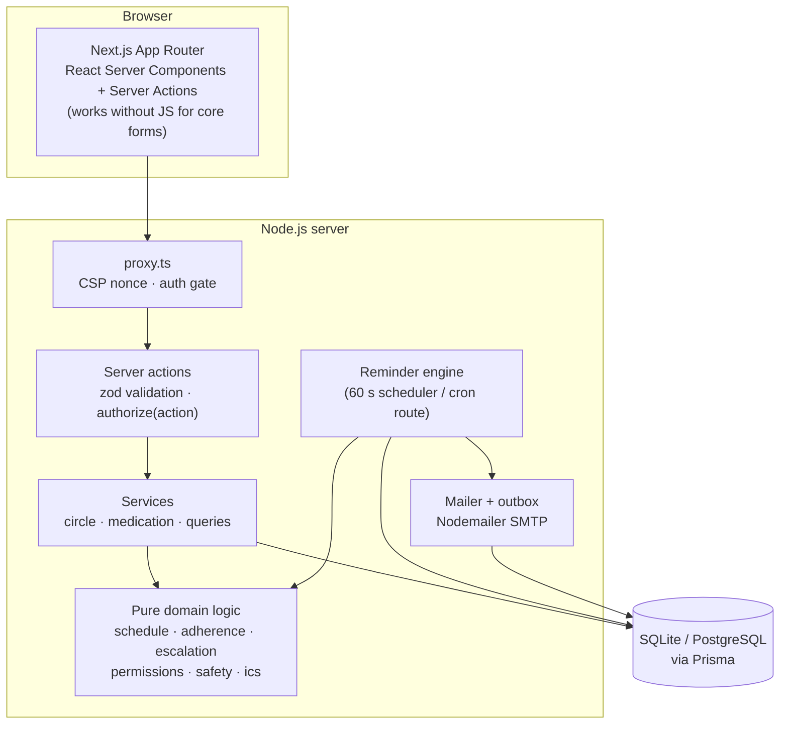

# Saathi — care that never forgets

> **साथी** (*saathi*) — Hindi for "companion".
> A shared, secure care circle that helps elderly people manage medicines, doctor visits and daily healthcare routines — while keeping caretakers and family informed, and keeping the elder in charge of their own care.

Saathi is not a reminder app. It is a small **care system**: one health profile at the centre, a circle of people around it with their own passcodes and roles, a reminder engine that **escalates gently** when a dose goes unconfirmed, a **senior safety check** for risky medicine combinations, and **consent mode** so nothing about an elder's treatment changes without their yes.

---

## Try it in 30 seconds

```bash
npm install
cp .env.example .env
npm run setup        # creates the SQLite database + seeds the demo circle
npm run dev          # http://localhost:3000
```

`npm run setup` prints three sign-in PINs for the demo circle (care code **`CARE-2468`**): Kamala (elder), Priya (caretaker) and Rahul (son, family admin). They are generated at random on every seed — or set your own with `DEMO_ELDER_PIN`, `DEMO_CARETAKER_PIN` and `DEMO_FAMILY_PIN` in `.env`. **No credentials are stored in this repository**, and the demo uses exactly the same PIN sign-in as every other circle (there is no "demo bypass").

Open the landing page → **Open Kamala's demo circle**, tap a name and enter its PIN.

The demo has six weeks of realistic dose history, a pending change request waiting for Kamala's approval, appointments with questions for the doctor, a low-stock medicine and real safety findings.

---

## How it answers the problem statement

| The brief asks for… | What Saathi does |
|---|---|
| A **shared ecosystem** for elders, caretakers and family | A *care circle* per elder. Members have roles (**Elder**, **Caretaker**, **Family**, plus *admin*) enforced by one tested permission matrix (`src/lib/domain/permissions.ts`). |
| **Secure, passcode-based access** | A public **care code** (`K7QM-4XPA`, ~40 bits, no look-alike characters) + a **personal 6–8 digit PIN** per member, hashed with **scrypt**. Weak PINs (123456, 111111…) are refused. 5 wrong PINs → 15-minute pause per person, plus per-IP rate limits. New members join with **single-use, 72-hour invite codes** stored only as SHA-256 hashes. |
| **View, add, edit, manage medication schedules** | Medicines with strength, form, dose, multiple daily times, weekdays, start/end dates, food rules, purpose, pill colour/appearance and stock. Schedules are **timezone- and DST-aware** (Luxon). |
| **Track adherence** | One-tap **Taken / Skip (with reason) / Undo** on a large-target "Today" screen. Insights page with a 7/30/90-day calendar heatmap, per-medicine and time-of-day breakdowns, a perfect-day streak and **rule-based insights** ("Night doses are the hardest — 4 of 6 missed"). |
| **Manage healthcare routines** | **Routines** for the habits and home checks around the medicines — blood-pressure, blood-sugar, pulse and weight checks, walks, physiotherapy. Each appears on Today with a gentle email reminder. Readings are range-checked against published adult guidance: **high/low readings email the elder and caretakers, urgent ones the whole circle**, with plain-language advice. Trends appear in Insights and on the health card. |
| **Monitor upcoming doctor appointments** | Appointments with doctor, place, transport plan, notes, a **"questions for the doctor"** list the elder builds themselves, post-visit outcome notes and **.ics calendar export**. |
| **Email reminders for missed meds, upcoming doses and appointments** | A minute-by-minute **reminder engine** with an **escalation ladder**, appointment reminders (day before + 2 h before), refill forecasts and an evening family digest — all delivered exactly once through a deduplicated outbox. |
| **Go beyond a basic reminder app** | Escalation ladder · health-reading alerts · consent mode · senior safety check (interactions, allergies, duplicates, dose spacing, Beers Criteria®) · refill forecasting · adherence insights · printable health card · audit trail · quiet hours · read-aloud · large-text & high-contrast modes. |
| **Elders at the centre of their own decisions** | **Consent mode**: medicine changes proposed by anyone else become requests the elder approves or declines. Only the elder can switch consent off. The elder can't be removed from their own circle. |

---

## The escalation ladder



Every circle can tune the three timings (validated so the ladder always climbs). Doses due at the same moment are grouped into **one** email per person. Quiet hours hold non-urgent emails; missed-dose alerts still get through.

### Exactly-once delivery

`runReminderSweep()` (`src/lib/server/reminders.ts`) is a pure function of `(database, mailer, now)`. Every email has a deterministic **dedupe key** (e.g. `dose-missed:<profile>:<slot>:<member>`) with a `UNIQUE` constraint in the `Notification` table. The row is inserted *before* sending, so overlapping runs — the in-process scheduler **and** an external cron — can never double-send. Failures are recorded with the SMTP error and visible in the in-app **Email outbox**.

Two ways to run it:

* **Long-running server** (default): `src/instrumentation.ts` starts a 60-second scheduler.
* **Serverless / external cron**: set `REMINDER_SCHEDULER=off` and call `POST /api/cron/reminders` with `Authorization: Bearer $CRON_SECRET` (constant-time compared), or run `npm run reminders:run` from system cron.

Without SMTP settings every email is still written to the outbox (status *Preview*), so the whole flow is demoable offline. Add any SMTP provider (Gmail app password, Resend, Brevo, SES, Mailtrap) in `.env` to deliver for real.

---

## Senior safety check

An offline, explainable knowledge base (`src/lib/domain/safety.ts`) that recognises generic **and** common Indian/US brand names (Ecosprin, Glycomet, Thyronorm, Shelcal, Combiflam…) and flags:

* **Major interactions** — e.g. blood thinners + NSAIDs, nitrates + sildenafil, SSRIs + tramadol, benzodiazepines + opioids, ACE/ARB + potassium-raising drugs, simvastatin + clarithromycin.
* **Timing conflicts** — e.g. levothyroxine needs 4 h away from calcium/iron; it checks the *actual scheduled times* and says "Timed correctly" when they are.
* **Allergy conflicts** by drug class (e.g. "Penicillin" allergy vs Augmentin).
* **Duplicate therapy** (two paracetamol products, two acid reducers).
* **AGS Beers Criteria®** cautions for people 65+ (sedatives, first-generation antihistamines, sulfonylureas…).

Findings are shown next to the medicine, on the Today screen and on the printable health card — always with a "confirm with your doctor or pharmacist" disclaimer.

---

## Architecture



* **Domain logic is pure and framework-free** (`src/lib/domain/*`) — easy to test, no I/O.
* **Services** take the Prisma client as a parameter, so integration tests run them against a real throwaway database.
* **Every mutation** goes through a server action that authenticates the session, checks the permission matrix, validates input with Zod and writes an audit-log entry.

```
src/
  app/                 routes (landing, access, start, join, /app/*, /api/*)
    actions/           server actions (auth, medications, appointments, circle, settings)
  components/          ui kit, landing sections, app widgets
  lib/
    domain/            pure logic: schedule, adherence, escalation, permissions, safety, time, ics
    server/            db, session, crypto, rate-limit, services, queries, reminders, scheduler
    email/             templates (escaped, testable) + mailer/outbox
    validation/        zod schemas for every form
  proxy.ts             per-request CSP nonce + /app auth gate
prisma/                schema + demo seed
tests/                 unit, integration (real SQLite), component a11y, e2e (Playwright + axe)
```

---

## Security

| Concern | Measure |
|---|---|
| Passcodes | scrypt (N=2¹⁵, r=8) with per-hash salt, constant-time comparison; weak-PIN policy; dummy-hash work for unknown members (no timing oracle). |
| Brute force | Per-member lockout (5 tries → 15 min, logged to the audit trail) + **per-circle** limit on sign-in attempts (holds even if a client forges `X-Forwarded-For`) + per-IP limits on sign-in, code lookup, sign-up and email actions. |
| Sessions | `__Host-` prefixed cookie in production; 256-bit random tokens; only the SHA-256 is stored; `HttpOnly`, `SameSite=Lax`, `Secure` in production; revoked when a member is removed, and other devices are signed out when a PIN changes. |
| Secrets | No credentials in source: `.env` is git-ignored, demo PINs come from env vars or are generated at seed time, e2e tests generate fresh random PINs per run, test fixtures are labelled as such. |
| Authorisation | Single permission matrix; every query is scoped by the member's `profileId` (no IDOR); dose logs must match a real scheduled instant. |
| Input | Zod schemas for every form; lengths capped; enumerations whitelisted; health readings range-checked; form parsing uses null-prototype objects (no prototype pollution); open-redirect-safe `?next=`. |
| Data minimisation | Expired sessions, dead invites and outbox entries older than 180 days are purged hourly. |
| Supply chain | `npm audit` clean (0 vulnerabilities), Dependabot for npm and Actions, CodeQL `security-and-quality` scanning. |
| XSS / injection | React escaping; email templates HTML-escape all user text and strip CR/LF from subjects; email previews rendered in a fully sandboxed `<iframe>`; Prisma parameterised queries. |
| Headers | Nonce-based **CSP** with `strict-dynamic`, `frame-ancestors 'none'`, HSTS, `nosniff`, `Referrer-Policy`, `Permissions-Policy`, COOP; `X-Powered-By` removed; private pages `Cache-Control: no-store`. |
| CSRF | Server Actions' built-in Origin check + `SameSite=Lax` cookies. |
| Cron | Bearer secret (≥16 chars) compared with `timingSafeEqual`. |
| Privacy | Other members' emails are masked; only names and roles are shown before sign-in; health data never leaves the circle. |

See [docs/SECURITY.md](docs/SECURITY.md).

## Accessibility

Built for older eyes and hands, and checked automatically with **axe-core** in unit tests and in a real browser (Playwright, WCAG 2.2 AA tags):

* **Text size** (A / A+ / A++) and **high-contrast** mode, stored in a cookie so pages render correctly on the server with no flash.
* **Read my day aloud** (on-device speech synthesis — no data leaves the device).
* 44–56 px touch targets, 12-hour times, plain-language labels ("For blood pressure"), pill colour swatches.
* Skip link, landmarks, labelled forms with linked hints/errors (`aria-describedby`), live regions for results, `aria-current` navigation, keyboard-operable everything, visible focus rings, `prefers-reduced-motion` respected, text alternatives for every chart (including a screen-reader table for the heatmap).

See [docs/ACCESSIBILITY.md](docs/ACCESSIBILITY.md).

## Testing

```bash
npm test               # 193 unit, integration, server-action and component accessibility tests (Vitest)
npm run test:coverage  # with enforced coverage thresholds
npm run test:e2e       # Playwright end-to-end + axe scans, desktop & mobile
npm run lint && npm run typecheck
```

| Layer | What is tested | Coverage (lines) |
|---|---|---|
| Domain logic | schedules (incl. DST), adherence, insights, escalation ladder, permissions, safety rules, vital-sign thresholds, ICS, formatting | 96 % |
| Validation | every form schema, PIN policy, reading ranges, prototype-pollution guard | 100 % |
| Server services | reminder engine (idempotency, grouping, quiet hours, failures, appointments, refills, routines, digest), sign-in lockout, invites, dose & routine logging, alerts, housekeeping — against a real SQLite database | 93 % |
| **Server actions** | sessions & expiry, role enforcement, IDOR scoping, consent-mode approval flow, sign-in/redirect safety, PIN change revoking devices, settings, appointments, circle management | 92 % |
| Components | axe-core on the dose card, form fields and quiz (jsdom) | — |
| End to end | sign-in, wrong PIN, auth gate, security headers, cron auth, consent flow, routines, display preferences, and an axe WCAG 2.2 AA scan of **every page** on desktop and mobile | 24 tests |

Coverage thresholds are enforced in CI (`vitest.config.mts`): 90 % of lines for `src/lib`, 85 % for server actions. CI (`.github/workflows/ci.yml`) runs lint, typecheck, coverage, `npm audit`, build and the e2e suite.

## Efficiency

* The **reminder engine's query count is constant** in the number of circles: one load of profiles (with members, medicines, routines), one batched query each for dose logs, routine logs and appointments, then every email is planned in memory and all dedupe keys are checked in one (chunked) query. Emails are rendered only if they will actually be sent.
* Today, Insights and the health card each load in **one round of parallel queries**, and pages reuse already-loaded data (e.g. the safety check runs on the medicines the page already fetched) instead of re-querying.
* Doses are computed from schedules rather than stored ahead of time, so there is no background job filling tables; old data is purged hourly.
* Dose matching uses hash maps / sets (O(n)), indexes on every hot query path (`profileId + scheduledFor`, `profileId + status`, …).
* Session lookups are memoised per request (`React.cache`); "last seen" writes are throttled to once per 5 minutes.
* The reminder engine's fast-path existence check avoids failed inserts; SMTP uses a pooled transport.

## Deployment

* **Docker / VPS / Render / Railway / Fly**: `docker build -t saathi . && docker run -p 3000:3000 -v saathi-data:/data --env-file .env saathi` — the scheduler runs in-process.
* **PostgreSQL**: change `provider` in `prisma/schema.prisma` to `postgresql` and set `DATABASE_URL`.
* **Vercel / serverless**: use PostgreSQL, set `REMINDER_SCHEDULER=off`, and point a cron at `POST /api/cron/reminders`.
* Don't run `npm run db:seed` against production — it only creates the sample demo circle.

Environment variables are documented in [.env.example](.env.example).

---

*Saathi is a reminder and coordination tool, not a medical device, and does not replace advice from a doctor or pharmacist.*
